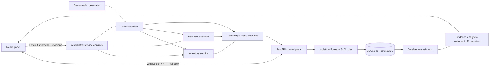

# Incident Pilot

[](https://github.com/berkayozdmr21/incident-pilot/actions/workflows/ci.yml)

### Gözlemle. Anla. Onayla.

Üç bağımsız HTTP mikroservisini izleyen, gerçek isteklerden anomali tespit eden, kanıtları analiz eden ve **operatör onayından sonra** sınırlı demo müdahaleleri uygulayan yerel operasyon laboratuvarı.

**React · FastAPI · SQLAlchemy · PostgreSQL / SQLite · Isolation Forest · OpenTelemetry · Prometheus · WebSocket**

> Bu proje bir demo ticaret sistemidir. Gerçek ödeme, müşteri, bulut hesabı veya üretim servisine bağlanmaz. Ekrandaki metrikler çalışan demo servislerinden ölçülür; tarihsel başarı veya üretim güvenilirliği olarak sunulmaz.

## Çalışan senaryo

1. Başlatıcı sipariş, stok, ödeme ve kontrol panelini ayrı süreçler halinde açar.
2. Otomatik demo trafik sipariş servisine gerçek HTTP istekleri gönderir. Sipariş, stok ve ödeme servislerini çağırır.
3. Panelden **Senaryo başlat → Ödeme → Gecikme ekle** seçilir. Ödeme istekleri 850 ms gecikir.
4. Kontrol katmanı son 20 saniyenin p95 gecikmesi ve hata oranını hesaplar. Kural / ML denetimi olay açar.
5. Kalıcı analiz kuyruğu servis loglarını, metrikleri, sürümü ve trace kimliklerini toplar.
6. Olaydaki **Gözden geçir** düğmesi uygulanacak değişikliği gösterir. Onay kutusu olmadan müdahale gönderilmez.
7. Onaydan sonra demo arızası kaldırılır. Olay hemen kapanmaz: son 20 saniyelik pencere ve üç ardışık sağlıklı ölçümle kapanış doğrulanır.

Hata yayılımını görmek için ödeme/stok servisinde **Hata üret**; rollback için **Sorunlu sürüm** senaryosunu deneyin. Sipariş servisindeki upstream hatası, alt servisin düzeltilmesiyle giderilir. Sipariş olayının tek başına arızasını kaldırmak alt servisi düzeltmez.

## Windows’ta başlatma

1. ZIP’i bir klasöre çıkarın.
2. Python 3.10+ kurulu olmalı. **`BASLAT.cmd`** dosyasına çift tıklayın.
3. İlk kurulumda Python bağımlılıkları indirilir. Dört boş yerel port seçilir.
4. Tüm servisler `/health` yanıtı verdikten sonra panel otomatik açılır.
5. Terminal açık kalmalıdır. Ctrl+C bütün başlatılan demo süreçlerini durdurur.

ZIP derlenmiş React arayüzünü içerir; Node.js gerekmez. Git kaynak kodundan çalıştırırken frontend build yoksa Node.js 22+ ve npm gereklidir. Hata kayıtları: `data/orders.log`, `data/payments.log`, `data/inventory.log`, `data/pilot.log`.

```powershell
python -m venv .venv
.\.venv\Scripts\Activate.ps1
pip install -r requirements.txt
python run.py
```

macOS/Linux aktivasyonu: `source .venv/bin/activate`.

İlk bağımlılık kurulumu internet ister. API anahtarı olmadan servisler, tespit, kanıt analizi, onay ve müdahale çalışır. Google Fonts erişilemezse sistem fontları kullanılır.

## Docker ve PostgreSQL

```sh
docker compose up --build
```

Panel: http://127.0.0.1:8950. Üç servis Docker iç ağında kalır; yalnızca panel portu loopback’e açılır. PostgreSQL kalıcı volume kullanır. Veritabanı kimlikleri bu yerel demo için sabit örnek değerlerdir; dış ortamda kullanılmamalıdır. `CONTROL_TOKEN` için `.env.example` dosyasını `.env` olarak kopyalayıp rastgele bir değer yazabilirsiniz. Normal `run.py` her başlatmada kendi rastgele servis kontrol token’ını üretir.

### Prometheus ve Jaeger

PowerShell:

```powershell
$env:OTEL_EXPORTER_OTLP_TRACES_ENDPOINT="http://jaeger:4318/v1/traces"
docker compose --profile observability up --build
```

macOS/Linux:

```sh
OTEL_EXPORTER_OTLP_TRACES_ENDPOINT=http://jaeger:4318/v1/traces docker compose --profile observability up --build
```

- Prometheus: http://127.0.0.1:9090
- Jaeger: http://127.0.0.1:16686
- Panel metrikleri: `/metrics`
- Servis metrikleri: `/metrics/`

OTLP adresi ayarlanmazsa trace context ve paneldeki trace kimlikleri yine çalışır; Jaeger’e span gönderilmez. Yapılandırma [OpenTelemetry Python](https://opentelemetry.io/docs/languages/python/exporters/) ve [Prometheus ASGI](https://prometheus.github.io/client_python/exporting/http/asgi/) arayüzlerini kullanır. Docker motoru bu geliştirme ortamında açık olmadığı için konteynerler ve Jaeger/Prometheus çalışma zamanı burada doğrulanmadı; Compose yapılandırması doğrulandı.

## Mimari



### Gerçek servisler

| Servis | İş endpoint’i | Davranış |
|---|---|---|
| orders | POST `/checkout` | Önce stok rezervasyonu, sonra ödeme HTTP çağrısı |
| inventory | POST `/reserve` | Demo rezervasyon yanıtı; gerçek stok yönetimi içermez |
| payments | POST `/charge` | Demo ödeme yanıtı; ödeme sağlayıcısına bağlanmaz |

Her servis `/health`, `/telemetry`, `/metrics/` ve token korumalı `/admin/control` sunar. Telemetri en son 3.000 isteği ve 100 log kaydını süreç belleğinde tutar. OpenTelemetry FastAPI/HTTPX enstrümantasyonu bağımlılıklar arasında trace context taşır. Yerel başlatıcı dört ayrı uvicorn süreci açar.

### Kalıcı veri ve işler

Olaylar, analiz işleri, onay/işlem kayıtları ve metrik snapshot’ları SQLAlchemy ile saklanır. Yerelde SQLite, Docker’da PostgreSQL. Analiz işleri `queued → running → done/failed` geçişleriyle kalıcı bir SQL kuyruğunda tutulur; kontrol katmanındaki async worker bunları işler. Ayrı Redis/Celery kurulumu gerekmez.

Worker işi koşullu SQL güncellemesiyle sahiplenir. 60 saniyeden eski `running` lease yeniden kuyruğa alınabilir. Başarısız analiz arayüzden yeniden istenebilir. Bu sürüm **tek kontrol katmanı / tek worker** için tasarlanmıştır; çoklu replica ve exactly-once dağıtık işleme garantisi yoktur.

Snapshot saklama: 2 saat. Panel son 60 snapshot, son 100 olay, 70 audit kaydı ve 30 işi gösterir. Olay/audit kayıtları veritabanında kalır. Uygulama yeniden başlatılınca servis belleği sıfırlanır; olay ve analiz geçmişi korunur.

## Anomali tespiti

- Isolation Forest, seed=42 ile üretilmiş 600 sentetik sağlıklı pencere üzerinde başlangıçta eğitilir.
- Özellikler: p95 gecikme, hata oranı, saniyedeki istek.
- Kural: hata oranı ≥ %15 veya p95 ≥ 600 ms.
- ML outlier yalnızca p95 >250 ms veya hata oranı >%5 gibi operasyonel etkiyle birlikte olay açar. Trafik değişimi tek başına olay açmaz.
- Üçten az istek varsa sağlıklı/bozuk sınıflaması yerine ısınma durumu gösterilir. Erişilemeyen servis ayrı ele alınır.
- Başlangıçta kısa bir servis açılış toleransı vardır.

Model skoru kalibre edilmiş arıza olasılığı değildir. Pencere eşikleri ve sentetik dağılım demo varsayımlarıdır. Gerçek ortamda servis bazında tarihsel normal veri ve ayrı olay etiketleriyle yeniden değerlendirilmelidir.

```sh
python ml/evaluate.py
```

Değerlendirme ayrı seed ile üretilen 200 sentetik pencere üzerinde kural motoru ve birleşik dedektörü karşılaştırır. [ml/evaluation_report.json](ml/evaluation_report.json) raporu sonuçları içerir. Test arızaları eşik tanımlarıyla örtüştüğünden yüksek skorlar beklenir; **üretim başarı oranı değildir**.

## Analiz ve isteğe bağlı dil modeli

Varsayılan analiz motoru metrik, hata logu ve sürüm değişikliğinden açıklanabilir hipotez oluşturur. Kanıtlar `E1`, `E2` kimlikleriyle gösterilir. Hipotez, kesin kök neden teşhisi olarak sunulmaz. Demo hatalarının bilinen log mesajları kullanılır; bilinmeyen gerçek sistem arızalarında genelleme iddiası yoktur.

İsteğe bağlı model anlatımı için `.env.example` dosyasını `.env` adıyla kopyalayın:

```dotenv
OPENAI_API_KEY=kendi_anahtarin
OPENAI_MODEL=gpt-4.1-mini
```

`run.py` `.env` dosyasını okur. Sunucuyu yeniden başlatın. Yalnızca toplanan demo kanıtlar OpenAI API’ye gönderilir; bu kullanım ücretli olabilir. Anahtarı repoya göndermeyin. Model erişimi ve bakiye kendi hesabınıza bağlıdır.

LLM yalnızca anlatım ekler. Araç yürütmez, shell komutu çalıştırmaz, planı değiştirmez. Kaynak numaraları geçersizse veya API hatası varsa yerel analiz korunur. Geçerli atıf numarası, metindeki tüm iddiaların doğru olduğunu garanti etmez. Gerçek API çağrısı bu ortamda yapılmadı; başarı/hata yolları taklit yanıtlarla test edildi.

## Onay ve müdahale

- Arayüz uygulanacak servis ve işlemi önce gösterir.
- Açık onay kutusu + `approved=true` gerekir.
- Olay revizyonu ve analizdeki servis revizyonu uyuşmalıdır.
- Koşullu SQL güncellemesi aynı onayın tekrar yürütülmesini engeller.
- Servis kontrolü sabit izinli işlemlerle sınırlıdır: `clear_fault`, `rollback`, `reset_runtime`.
- Plan dışındaki işlem reddedilir; model çıktısı yeni komut ekleyemez.
- Kontrol başarısızsa audit kaydı oluşturulur ve olay açık kalır.
- Onay başarılı olsa bile durum `mitigating / recovering` olarak kalır; üç ardışık sağlıklı ölçümle `resolved` olur.

`rollback`, demo servisinin sürüm işaretini önceki sürüme döndürür ve enjekte edilmiş arızayı kaldırır; gerçek container image veya Git sürümü deploy etmez. `reset_runtime`, demo uygulama durumunu sıfırlar; işletim sistemi sürecini yeniden başlatmaz. Varsayılan analiz planları `clear_fault` veya uygun durumda `rollback` önerir. Erişilemeyen süreç panelden başlatılmaz.

Üç sağlıklı ölçüm aynı kayan pencereyi kısmen paylaşır; istatistiksel bağımsızlık veya tam üretim iyileşmesi garantisi değildir. Demo trafiği durursa yeni yeterli örnek toplanamayacağı için doğrulama bekleyebilir.

## API

| Method | Endpoint | Açıklama |
|---|---|---|
| GET | `/api/health` | Kontrol katmanı durumu |
| GET | `/api/dashboard` | Servisler, olaylar, loglar, işler ve zaman çizgisi |
| WS | `/api/live` | 2 saniyede bir durum yayını |
| POST | `/api/load` | Demo trafik aç/kapat |
| POST | `/api/scenarios` | İzinli demo arızası enjekte et |
| POST | `/api/incidents/{id}/analyze` | Analizi kuyruğa al |
| POST | `/api/incidents/{id}/approve` | Gözden geçirilmiş planı onayla ve uygula |
| GET | `/api/incidents/{id}/report` | Markdown olay raporu indir |
| GET | `/metrics` | Prometheus metrikleri |

Yazma çağrıları `X-Pilot-Client: dashboard` başlığı ister. Tarayıcı Origin/Host eşleşmesi denetlenir; cross-origin mutasyon ve WebSocket erişimi reddedilir. Bu mekanizmalar **kullanıcı kimlik doğrulaması değildir**. API dokümantasyonu `/docs` adresinde; dokümantasyondan yazma çağrısı için özel başlığı ayrıca eklemek gerekir.

## Testler ve doğrulama

```sh
python -m unittest discover -s tests -v
cd frontend
npm ci
npm test
npm run build
```

- 16 Python testi: gerçek ASGI servis HTTP akışı, trace yayılımı, gecikme, hata zinciri, rollback, açık onay, revizyon kontrolü, onay tekrarının reddi, sağlıklı ölçümle kapanış, queue lease, Origin/token denetimi, metrikler ve LLM fallback.
- 6 React testi: onay kutusu, revizyon gönderimi, eski onay hatası, senaryo seçimi, erişilemeyen servis engeli ve modal etkileşimi.
- Entegrasyon testleri HTTPX ASGI transport ile gerçek uygulama endpoint’lerini çalıştırır; ayrı OS süreci/TCP taşıması kullanmaz.
- GitHub CI kaynak koddan frontend build, tüm testler ve dedektör değerlendirmesini çalıştırır.

Docker ve tarayıcı doğrulama sınırları: [VERIFICATION.md](VERIFICATION.md).

## Geliştirme

```sh
git clone https://github.com/berkayozdmr21/incident-pilot.git
cd incident-pilot
```

```text
pilot/        Kontrol katmanı, kalıcı veri, kuyruk, tespit ve kanıt analizi
services/     Bağımsız sipariş/ödeme/stok FastAPI uygulamaları
frontend/     React operasyon paneli
infra/        Prometheus yapılandırması
ml/           Tekrarlanabilir sentetik dedektör değerlendirmesi
tests/        Servisler arası entegrasyon ve güvenli işlem testleri
run.py        Dört süreç, boş portlar, readiness ve temizlik
```

Yerel tek kullanıcılı MVP’dir. Çok kullanıcılı üretim için kimlik doğrulama/RBAC, TLS, rate limiting, migration yönetimi, servis bazlı tarihsel eğitim, dışarı alınmış worker ve iş lease heartbeat’leri gerekir. Shell veya container yönetim yetkisi bulunmaz. Olay analizine gerçek müşteri logu bağlamadan önce veri minimizasyonu ve anahtar maskeleme uygulanmalıdır.

## Geliştirici

[Berkay Özdemir](https://github.com/berkayozdmr21)
